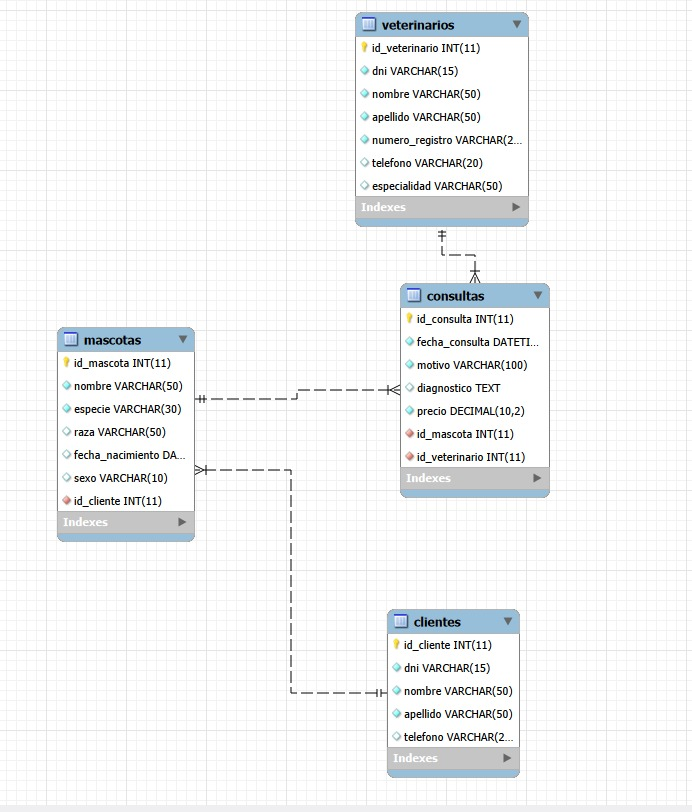

# 🐾 PetCare - Base de Datos INTEGRADOR

## 📋 Descripción del proyecto

Este proyecto corresponde al Trabajo Práctico N°6 - Integrador.

Se desarrolla el modelo **PetCare**, un sistema de gestión veterinaria destinado al control de clientes, mascotas, veterinarios y consultas médicas.

## 🎯 Objetivo

Diseñar e implementar webapp funcional en PHP conectada a la base de datos diseñada en el TP5:

- **Funcionalidades**: Conexión a BD, ABM (CRUD), registro/login, sesiones, cambio de contraseña y control de acceso por roles (Admin, Usuario común y Rol especializado).
- **Git**: Trabajo continuo en el repositorio (se evaluará el historial de commits).
- **Despliegue**: El sistema debe estar subido y funcional en un hosting gratuito (ej. InfinityFree).
- **Documentación**:  Incluir script de la base de datos en /database, usuarios de prueba y archivo README.md.

## 🗂️ Modelo de datos

La base de datos está compuesta por cuatro entidades principales:

- **Clientes:** almacena los datos de los propietarios.
- **Veterinarios:** contiene la información de los profesionales.
- **Mascotas:** registra las mascotas asociadas a cada cliente.
- **Consultas:** almacena las consultas veterinarias realizadas a las mascotas.

## 📊 Diagrama Entidad-Relación (DER)

## 📄 Consigna del Trabajo Práctico

[📥 Abrir consigna original en PDF](assets/consigna.pdf)

## 📄 Guia complementaria

[✌️ Abrir guía complementaria en PDF](assets/complement.pdf)

## 💾 Archivos del proyecto

| Archivo | Descripción |
|---|---|
| `tp5.sql` | Script SQL con la creación de la base de datos, tablas e inserción de datos. |
| `assets/DER.png` | Diagrama Entidad-Relación exportado como imagen. |
| `assets/consigna.pdf` | Documento original con las consignas del trabajo. |

## 🛠️ Herramientas utilizadas

- MySQL
- MySQL Workbench
- XAMPP

---
**Trabajo Práctico N.º 5 - Bases de Datos Relacionales**